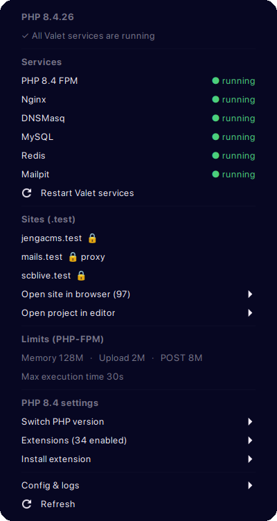

# PHP Monitor for Cinnamon

A Cinnamon panel applet for PHP developers using
[Valet Linux](https://github.com/genesisweb/valet-linux-plus). It shows your
active PHP version on the panel and puts your local dev services and sites one
click away. Inspired by [PHP Monitor](https://github.com/nicoverbruggen/phpmon)
for macOS; this is an independent project, not affiliated with it.

<p align="center"></p>

## Features

- **PHP version on the panel.** The label turns red if a Valet service
  (PHP-FPM, Nginx, DNSMasq) isn't running; the tooltip says which.
- **Service status and control.** PHP-FPM, Nginx, DNSMasq, MySQL/MariaDB,
  PostgreSQL, Redis, Memcached, Mailpit and Meilisearch (whichever are
  installed), each with its state. Click one to restart it, or start it if it's
  stopped. "Restart Valet services" restarts PHP-FPM, Nginx and DNSMasq.
- **Auto-repair after login.** With an encrypted home folder, PHP-FPM and Nginx
  start at boot before your files are available, fail, and your `.test` sites
  stay down. The applet restarts them once after you log in.
- **Sites.** Secured (🔒), proxied and linked sites are listed directly; every
  parked site is in "Open site in browser" and "Open project in editor".
- **PHP limits** as PHP-FPM sees them (what your sites get): memory, upload,
  POST size and max execution time.
- **Switch PHP version.** Pick any version Valet supports (8.2, 8.3, 8.4 with
  valet-linux-plus 2). It runs `valet use <version> --update-cli` in a terminal,
  which also installs the version if it's missing. If the command line and your
  sites end up on different versions, the menu says so.
- **Extensions.** A switch per extension shows whether it's enabled for
  PHP-FPM. Toggling runs `phpenmod`/`phpdismod` (you'll be asked for your
  password) and restarts PHP-FPM.
- **Install extension.** Common extensions available from your PHP repository
  but not installed (Xdebug, PCOV, Redis, Imagick, PostgreSQL and more), each
  installed with `apt` in a terminal.
- **Xdebug mode.** Once Xdebug is installed, choose off, develop, debug,
  coverage, profile or trace. The mode is written to
  `/etc/php/<version>/{fpm,cli}/conf.d/99-phpmon-xdebug.ini`.
- **Config & logs.** php.ini for PHP-FPM and CLI, the Nginx error log, and
  Valet's logs, Nginx config and settings folders.

The applet never reads or shows the database credentials stored in Valet's
`config.json`.

Service restarts are passwordless once the polkit rule is installed. Changing
PHP configuration (extensions, Xdebug mode) and installing packages always ask
for your password.

## Prerequisites

| Prerequisite | Why it's needed | How to check |
| --- | --- | --- |
| Cinnamon 6.x desktop | Runs the panel applet | `cinnamon --version` |
| Valet Linux (valet-linux-plus) | Sites, Nginx config and PHP-FPM socket | `valet --version` |
| PHP with PHP-FPM, e.g. from the ondrej PPA | PHP version and limits | `php -v` and `php-fpm8.4 -v` (use your version) |
| systemd and polkit | Service status and passwordless control | `systemctl --version` and `pkaction --version` |
| Python 3 | Runs the helper script | `python3 --version` |
| A terminal set as `x-terminal-emulator` | Shows version switches and installs | `x-terminal-emulator --version` |

Valet Linux installs PHP-FPM, Nginx and DNSMasq for you. If you're setting up
from scratch on Ubuntu or Linux Mint:

```sh
# PHP from the ondrej PPA (swap 8.4 for the version you want)
sudo add-apt-repository ppa:ondrej/php
sudo apt update
sudo apt install php8.4-cli php8.4-fpm php8.4-curl php8.4-mbstring php8.4-xml php8.4-zip

# Composer, then Valet Linux
sudo apt install composer
composer global require genesisweb/valet-linux-plus
~/.config/composer/vendor/bin/valet install
```

Python 3, systemd and polkit come with every Ubuntu and Linux Mint install.

## Installation

1. Link the applet into Cinnamon's applet folder:

   ```sh
   ln -s "$PWD/phpmon@PhillipMwaniki" ~/.local/share/cinnamon/applets/
   ```

2. Allow your user to start, stop and restart the dev services without a
   password (needed for auto-repair; without it you'll get a password prompt
   each time):

   ```sh
   pkexec sh polkit/install.sh
   ```

   This writes `/etc/polkit-1/rules.d/50-phpmon-cinnamon.rules`. It only covers
   start/stop/restart of the services listed above, for your user only. Remove
   it with `pkexec sh polkit/install.sh --uninstall`.

3. Open **System Settings → Applets**, find **PHP Monitor** and add it to your
   panel.

## Settings

Right-click the applet and choose **Configure**:

| Setting | Default |
| --- | --- |
| Restart failed Valet services after login | On |
| Check service status every | 15 seconds |
| Editor command for opening projects | `code` |

## How it works

- `applet.js` draws the panel label and menu, and refreshes it on a timer and
  whenever you open the menu.
- `helper.py` does the work:
  - `helper.py status` prints a JSON snapshot of PHP, services, limits, paths
    and sites;
  - `helper.py restart|start|stop <service>` controls one service, and refuses
    anything outside the list above;
  - `helper.py repair` restarts failed Valet services, PHP-FPM first;
  - `helper.py ext <version> <name> on|off` and
    `helper.py xdebug-mode <version> <mode>` change PHP configuration through
    `pkexec`, then restart PHP-FPM.
- `polkit/install.sh` installs the passwordless rule.

## Roadmap

- Per-site PHP versions (`valet isolate`)
- Secure and unsecure sites from the menu
